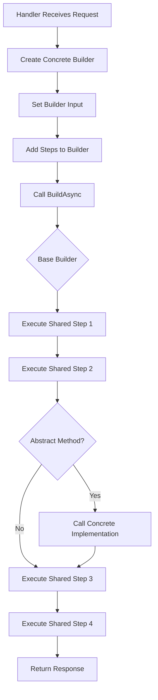

# Authentication Base Builder Pattern Feature

## Overview

The Authentication Base Builder Pattern is a DRY (Don't Repeat Yourself) architectural pattern that eliminates code duplication between tenant and host authentication operations. It provides reusable base builder classes and interfaces that encapsulate shared authentication logic while allowing tenant/host-specific implementations where needed.

## Problem Statement

Before implementing base builders, authentication operations (login, logout, refresh token, reset password, etc.) were duplicated between tenant and host implementations:

1. **Code Duplication**: Identical logic existed in both `LoginCommandBuilder` and `HostLoginCommandBuilder`, `RefreshTokenCommandBuilder` and `HostRefreshTokenCommandBuilder`, etc.

2. **Maintenance Burden**: Security fixes, improvements, and bug fixes had to be applied twice - once for tenant, once for host.

3. **Inconsistency Risk**: Tenant and host implementations could diverge over time, leading to different behaviors or security vulnerabilities.

4. **Testing Overhead**: Same logic had to be tested separately for tenant and host.

5. **Interface Duplication**: Builder interfaces had identical method signatures, violating DRY principles.

## Architecture & Design Decisions

### Component Structure

```
Base Interface (Abstractions)
    ↓
Base Builder (Implementations)
    ↓
    ├─ Tenant Builder (concrete)
    └─ Host Builder (concrete)
```

### Key Components

1. **Base Interface** (`ILoginCommandBuilderBase<TInput, TResponse>`)
   - Defines common method signatures
   - Eliminates interface duplication
   - Located in `Alforqan.Core/Builders/Abstractions/Identity/Base/Authentication/Commands/`

2. **Base Builder** (`LoginCommandBuilderBase<TInput, TResponse, TDbContext>`)
   - Abstract class with shared method implementations
   - Abstract properties for tenant/host-specific dependencies
   - Abstract methods for different implementations
   - Located in `Alforqan.Core/Builders/Implementations/Identity/Base/Authentication/Commands/`

3. **Concrete Builders**
   - **Tenant**: `LoginCommandBuilder` (uses `AppDbContext`)
   - **Host**: `HostLoginCommandBuilder` (uses `HostIdentityDbContext`)
   - Thin implementations that only provide dependencies and override abstract methods

### Design Patterns Used

1. **Template Method Pattern**: Base class defines algorithm structure, derived classes provide specific steps
2. **Strategy Pattern**: Abstract properties allow different implementations (UserManager, AuthService, etc.)
3. **Dependency Inversion**: Depend on abstractions (`ICustomAuthenticationService`, `IRefreshTokenRepo`) not concretions

## How It Works

### Flow Diagram



### Example: Login Flow

**Base Builder** (`LoginCommandBuilderBase`):
- `GetUserByUsernameOrEmail()` - Shared (queries UserManager)
- `CheckIfUserExists()` - Shared (validates user found)
- `SignInTheUser()` - **Abstract** (tenant uses SignInManager, host uses UserManager)
- `CheckIfSignInFailed()` - Shared (checks `_isPasswordValid`)
- `GenerateAccessTokenAndRefreshToken()` - Shared (uses AuthService)
- `AddRefreshTokenToDatabase()` - Shared (uses RefreshTokenRepo)
- `ReturnResponse()` - Shared (returns TokenResponseDto)

**Tenant Implementation**:
- Overrides `SignInTheUser()` to use `SignInManager.CheckPasswordSignInAsync()`
- Sets `_isPasswordValid = signInResult.Succeeded`

**Host Implementation**:
- Overrides `SignInTheUser()` to use `UserManager.CheckPasswordAsync()`
- Sets `_isPasswordValid` directly

### Abstract Properties Pattern

Base builders use abstract properties to inject tenant/host-specific dependencies:

```csharp
protected abstract UserManager<AppUser> UserManager { get; }
protected abstract ICustomAuthenticationService AuthService { get; }
protected abstract IRefreshTokenRepo RefreshTokenRepo { get; }
```

**Why Abstract Properties?**
- Allows base class to use dependencies without knowing concrete types
- Concrete builders provide correct instances (TenantUserManager vs HostUserManager)
- Type-safe: compile-time checking ensures correct implementations

### Interface Inheritance Pattern

Base interfaces eliminate method signature duplication:

```csharp
// Base interface
public interface ILoginCommandBuilderBase<TInput, TResponse>
    : IBuilder<TInput, TResponse>
{
    Task<GenericResponse<TResponse>> GetUserByUsernameOrEmail();
    // ... other methods
}

// Tenant interface
public interface ILoginCommandBuilder
    : ILoginCommandBuilderBase<LoginCommand, TokenResponseDto>
{
}

// Host interface
public interface IHostLoginCommandBuilder
    : ILoginCommandBuilderBase<HostLoginCommand, TokenResponseDto>
{
}
```

**Benefits**:
- Single source of truth for method signatures
- Changes to base interface automatically propagate
- Compile-time safety for interface compliance

## Implementation Examples

### Login Base Builder

**Location**: `Alforqan.Core/Builders/Implementations/Identity/Base/Authentication/Commands/LoginCommandBuilderBase.cs`

**Key Features**:
- 6 shared methods implemented in base
- 1 abstract method (`SignInTheUser()`) for different implementations
- Abstract properties for `UserManager`, `AuthService`, `RefreshTokenRepo`

### RefreshToken Base Builder

**Location**: `Alforqan.Core/Builders/Implementations/Identity/Base/Authentication/Commands/RefreshTokenCommandBuilderBase.cs`

**Key Features**:
- All methods shared (no abstract methods needed)
- Security-critical JWT validation with forced signature validation
- Constant-time comparison for refresh token validation
- Independent IP/UserAgent checks

### ResetPassword Base Builder

**Location**: `Alforqan.Core/Builders/Implementations/Identity/Base/Authentication/Commands/ResetPasswordCommandBuilderBase.cs`

**Key Features**:
- SHA256 hashing for reset codes (security)
- Constant-time code comparison
- User enumeration prevention
- Session invalidation (security stamp + token revocation)
- Email preparation outside transaction

## Integration with Existing Systems

### CQRS Pattern

Base builders integrate seamlessly with MediatR handlers:

```csharp
public async Task<GenericResponse<TokenResponseDto>> Handle(LoginCommand request, CancellationToken cancellationToken)
{
    var builder = loginCommandBuilder;
    builder.SetBuilderInput(request);
    return await builder
        .AddStep(builder.GetUserByUsernameOrEmail)
        .AddStep(builder.CheckIfUserExists)
        .AddStep(builder.SignInTheUser)
        .AddStep(builder.CheckIfSignInFailed)
        .AddStep(builder.GenerateAccessTokenAndRefreshToken)
        .AddStep(builder.AddRefreshTokenToDatabase)
        .AddStep(builder.ReturnResponse)
        .BuildAsync(cancellationToken);
}
```

### UserManagerFactory Pattern

Base builders use `IUserManagerFactory` to ensure `DbContext` consistency:

```csharp
// Tenant builder
private UserManager<AppUser> TenantUserManager =>
    _tenantUserManager ??= userManagerFactory.GetTenantUserManager(_dbContext);

// Host builder
private UserManager<AppUser> HostUserManager =>
    _hostUserManager ??= userManagerFactory.GetHostUserManager(_dbContext);
```

This ensures the `UserManager` uses the same `DbContext` instance as the builder's transaction.

### Service Interface Inheritance

Host services inherit from tenant services to enable casting:

```csharp
public interface IHostCustomAuthenticationService : ICustomAuthenticationService { }
public interface IHostRefreshTokenRepo : IRefreshTokenRepo { }
```

This allows base builders to use `ICustomAuthenticationService` and `IRefreshTokenRepo` while concrete builders inject host-specific implementations.

## Benefits

1. **DRY Principle**: Single implementation of shared logic
2. **Consistency**: Tenant and host behave identically for shared operations
3. **Maintainability**: Security fixes and improvements apply to both automatically
4. **Testability**: Base logic tested once, concrete builders test only differences
5. **Type Safety**: Generic constraints ensure correct usage
6. **Extensibility**: Easy to add new authentication operations following the same pattern

## Trade-offs

### Advantages

- **Reduced Code Duplication**: ~70% reduction in authentication builder code
- **Faster Development**: New auth operations can reuse base patterns
- **Security Consistency**: Security improvements automatically apply to both tenant and host

### Considerations

- **Abstraction Overhead**: Additional layer of inheritance (minimal impact)
- **Learning Curve**: Developers must understand base builder pattern
- **Namespace Organization**: Requires consistent folder structure

## Current Base Builders

The following authentication operations use base builders:

1. **Login** - `LoginCommandBuilderBase`
2. **RefreshToken** - `RefreshTokenCommandBuilderBase`
3. **Logout** - `LogoutCommandBuilderBase`
4. **LogoutFromAllDevices** - `LogoutFromAllDevicesCommandBuilderBase`
5. **ResetPassword** - `ResetPasswordCommandBuilderBase`
6. **ChangePassword** - `ChangePasswordCommandBuilderBase`
7. **SendResetPasswordCode** - `SendResetPasswordCodeQueryBuilderBase`

## When to Create a Base Builder

Create a base builder when:

1. **Same Operation Exists for Both Tenant and Host**: Login, logout, token refresh, etc.
2. **Significant Code Overlap**: >50% of logic is identical
3. **Security-Critical Operations**: Authentication, authorization, password management
4. **Future Maintenance Expected**: Operations likely to receive security fixes or improvements

**Don't create a base builder when**:
- Operations are completely different
- Only one implementation exists (tenant-only or host-only)
- Code overlap is minimal (<30%)

## Related Documentation

- `docs/technical-docs/authentication-base-builder-pattern-guide.md` - Implementation guide
- `docs/features-explanation-docs/builder-pattern-feature.md` - General builder pattern
- `docs/features-explanation-docs/host-identity-system.md` - Host identity system overview
